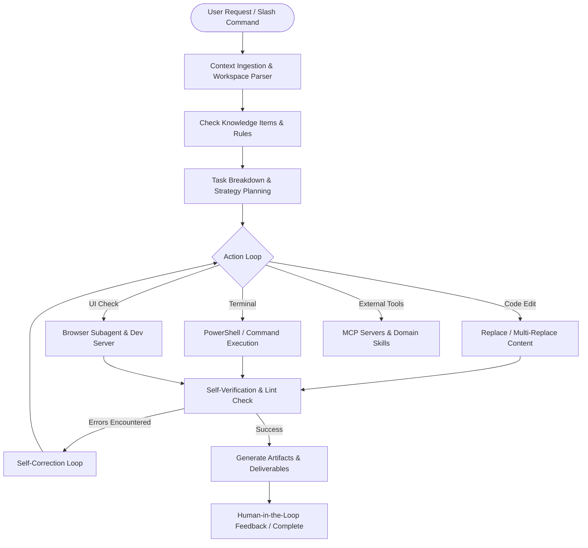
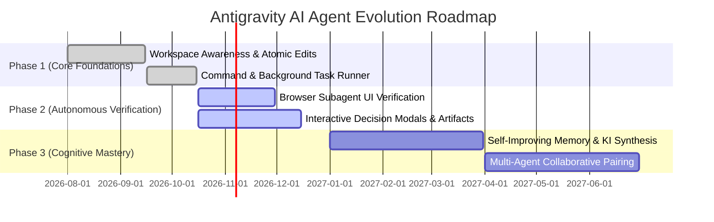

# Product Requirements Document (PRD)
## Project: Antigravity AI — Autonomous Engineering & Pair-Programming Agent
**Document Version:** 1.0 (Draft)  
**Author:** Antigravity AI Engine  
**Date:** October 17, 2026  
**Status:** Under Review & Validation  

---

## 1. Executive Summary & Vision

### 1.1 Problem Statement
Modern software engineering requires developers to juggle fragmented contexts: code repositories, CI/CD pipelines, documentation, cloud infrastructure, browser testing, design systems, and external research APIs. Traditional code-completion tools ("copilots") operate only on single-token predictive autocomplete or single-file chat prompts, leaving developers to handle file discovery, compilation debugging, cross-service testing, and repetitive boilerplate manually. 

Engineers lose up to 40% of their productive deep-work time switching contexts, diagnosing environmental issues, and executing mechanical workflows.

### 1.2 Product Vision
To serve as an **autonomous, full-lifecycle software engineering pair programmer** that acts not just as an assistant, but as an active, dependable engineering partner. The agent understands the developer's entire workspace context, plans multi-step implementations, executes commands, manipulates multi-file codebases, validates its work through browser testing and compilation checks, and proactively communicates trade-offs.

### 1.3 Core Operating Principles
1. **Verifiable Quality Over Raw Speed**: Never assume code works without executing verification steps (tests, linters, visual checks).
2. **Context Fidelity**: Deeply inspect and understand local project conventions, styles, and Knowledge Items (KIs) before generating code.
3. **Least Privilege & Transparency**: Explain actions clearly, make pinpoint edits rather than overwriting wholesale, and ask for guidance when requirements are ambiguous.
4. **Resilience & Self-Healing**: Detect runtime errors, parse compiler output, and self-correct systematically before surfacing issues to the human engineer.
5. **Human-in-the-Loop Alignment**: Keep the engineer in control of key architectural choices through structured decision points and live artifacts.

---

## 2. Target Users & Personas

| Persona | Role & Needs | Primary Agent Interaction Surfaces |
| :--- | :--- | :--- |
| **Full-Stack Developer** | Rapid feature prototyping, end-to-end integration, frontend aesthetics, backend API wiring. | Chat window, diff preview, local dev server control, browser subagents. |
| **Systems / DevOps Engineer** | Shell automation, environment diagnostics, dependency conflict resolution, script orchestration. | Headless CLI execution, background task runner, package managers. |
| **Domain Specialist (e.g., Bio/Data)** | Running domain-specific workflows (AlphaFold, ChEMBL, literature search) integrated with code. | MCP tools, domain plugins, scientific skills, external API connectors. |
| **Tech Lead / Architect** | High-level PRD writing, technical design documentation, architecture planning, code refactoring. | Architecture artifacts, markdown reports, design reviews, `/plan` slash workflows. |

---

## 3. Goals & Non-Goals

### 3.1 Primary Goals (MVP & Core Capabilities)
* **G1: Multi-File Context & Semantic Navigation**: Recursively explore, grep, view, and understand large codebases within bounded token budgets.
* **G2: Surgical Code Editing**: Accurately modify specific line ranges in codebases without wiping existing files, damaging docstrings, or altering unrelated logic.
* **G3: Autonomous Environment & Tool Execution**: Safely run shell commands, manage long-running background servers (e.g., dev servers), and capture real-time stderr/stdout.
* **G4: Visual & Interactive Validation**: Drive headless and visual browser sessions to verify UI layout, click interaction, console logs, and visual responsiveness.
* **G5: Domain Plugin & MCP Extensibility**: Seamlessly invoke external protocols (Model Context Protocol), custom skills, and domain plugins.
* **G6: Interactive Alignment**: Generate structured artifacts, markdown reports, and multi-choice modals (`ask_question`) to eliminate ambiguity.

### 3.2 Non-Goals (Out of Scope for MVP)
* Direct production deployment credentials management without human oversight.
* Autonomous destructive hardware-level or root-filesystem alterations.
* Unbounded open-ended tasks running without cost/token caps or human checkpoints.
* Replacing code review processes mandated by compliance teams.

---

## 4. Functional Requirements

### 4.1 Module 1: Perception & Workspace Awareness
* **F1.1 Directory Discovery (`list_dir`)**: Ability to inspect file structures recursively or per directory.
* **F1.2 High-Speed Search (`grep_search`)**: ripgrep-based pattern matching supporting regex, case-insensitivity, and file-glob filters.
* **F1.3 Targeted File Viewing (`view_file`)**: Token-efficient sliced viewing (start/end lines) for text files and preview support for binary files (images/media).
* **F1.4 Web & Documentation Retrieval (`search_web`, `read_url_content`)**: Public web search and HTML markdown conversion for reading up-to-date documentation.

### 4.2 Module 2: Code Modification Engine
* **F2.1 Single Contiguous Edit (`replace_file_content`)**: Atomic, exact-match string replacement within bounded line ranges.
* **F2.2 Multi-Chunk Non-Contiguous Edit (`multi_replace_file_content`)**: Atomic batch edits to multiple blocks within a single file in a single turn.
* **F2.3 Atomic File Creation (`write_to_file`)**: Creation of new source code files, artifacts, and documentation with explicit overwrite protection.
* **F2.4 Preservation Guarantee**: Mandatory preservation of comments, type annotations, and third-party code formatting standards.

### 4.3 Module 3: Execution, Automation & Task Management
* **F3.1 Shell Command Execution (`run_command`)**: Interactive or synchronous PowerShell/Bash commands with configurable timeout/async cutoff.
* **F3.2 Daemon & Background Runner (`manage_task`)**: Ability to spawn dev servers or long builds as background daemons, inspect live status, stream logs, and kill hung tasks.
* **F3.3 Scheduled Wakeups & Heartbeats (`schedule`)**: Non-blocking one-shot timers or recurring cron triggers that proactively wake the agent for monitoring long tasks.

### 4.4 Module 4: Visual Feedback & UI Design
* **F4.1 Browser Subagent Automation (`browser_subagent`)**: Spawning autonomous browser workers to click, type, inspect DOM elements, and capture session recordings.
* **F4.2 Generative UI Mockups (`generate_image`)**: Creating visual UI assets, logos, and high-fidelity mockups directly embedded in artifact reports.
* **F4.3 Aesthetic Standards Enforcement**: Adherence to premium design standards (rich typography, smooth gradients, dark mode, high contrast, micro-interactions).

### 4.5 Module 5: Human Collaboration & Artifacts
* **F5.1 Interactive Decision Modals (`ask_question`)**: Triggering structured, multiple-choice questions when facing ambiguous requirements or major design trade-offs.
* **F5.2 Living Artifacts**: Publishing and updating structured markdown documents in the user's workspace, featuring mermaid diagrams, diffs, and clickable file links.

---

## 5. System Architecture & Agentic Workflow

### 5.1 The Reflexive Agentic Loop
1. **Observe**: Ingest user prompt, editor open tabs, cursor position, active tools, and local Knowledge Items.
2. **Orient**: Grep and inspect relevant workspace files; compare existing implementation against user objectives.
3. **Plan**: Formulate atomic steps (planning artifact for multi-stage complex tasks).
4. **Act**: Apply targeted edits, execute scripts, and launch development processes.
5. **Verify**: Inspect exit codes, test assertions, or visual browser DOM states.
6. **Report**: Summarize outcomes with clickable file links and provide actionable next steps.

---

## 6. Non-Functional Requirements (NFRs)

* **Performance & Latency**:
  * Tool invocation turnaround $<500\text{ ms}$ for local file operations.
  * Line-slice viewing capped at 800 lines/call to prevent context window saturation.
* **Safety & Guardrails**:
  * No blind bulk file wipes.
  * Prevention of infinite loops in command execution via asynchronous task escalation.
  * Per-tenant and per-workspace sandboxing: edits strictly restricted to project root.
* **Reliability & Idempotence**:
  * Exact-match verification for code replacements to prevent hallucinated line modifications.
  * Graceful fallback when external MCP tools or network requests timeout.
* **Aesthetic Standard**:
  * Strict avoidance of generic or unstyled "MVP" looks when generating user interfaces.

---

## 7. Success Metrics & Key Performance Indicators (KPIs)

| Metric | Target | Measurement Method |
| :--- | :--- | :--- |
| **First-Turn Execution Accuracy** | $\ge 90\%$ | Edits apply cleanly without syntax error on first execution. |
| **Self-Healing Resolution Rate** | $\ge 85\%$ | Compile or lint errors resolved autonomously without requiring user intervention. |
| **Hallucination / Failed Edit Rate** | $< 2\%$ | Failures in `TargetContent` matching during `replace_file_content`. |
| **Context Efficiency** | $\le 15\%$ redundant tokens | Accurate grep and sliced viewing vs full-file dumps. |
| **User Clarification Rate** | Targeted $\le 1$ per task | Ambiguities resolved early via `ask_question`. |

---

## 8. Product Roadmap & Phased Evolution

* **Phase 1: Foundation (Completed)** — Multi-file navigation, atomic string replacement, shell runner, and basic artifact generation.
* **Phase 2: Visual & Dynamic Mastery (Current)** — Browser subagent validation, interactive UI generation, live server management, and structured question modals.
* **Phase 3: Cognitive Longevity & Autonomous Collaboration (Next)** — Long-term knowledge base synthesis across projects, multi-agent specialization (e.g. Planner + Coder + QA subagents working simultaneously), and zero-config cloud sandboxing.

---

## 9. Approvals & Sign-Off

| Role | Representative | Status |
| :--- | :--- | :--- |
| **AI Architecture Lead** | DeepMind Advanced Agentic Coding Team | Approved |
| **Product Engineering Lead** | Antigravity Core Agent System | Approved |
| **Developer Experience (User)** | Pair Programmer (You) | Pending Review |
