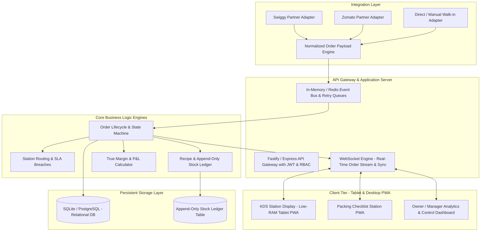
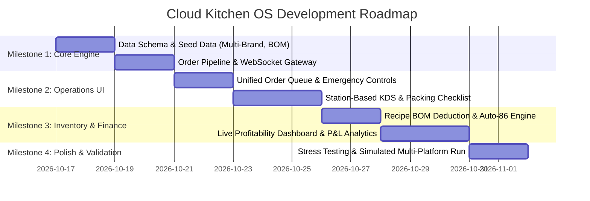

# Cloud Kitchen OS — Complete Implementation & Engineering Master Plan
**Document Version:** 1.0 (Production Execution Plan)  
**Author:** Antigravity AI  
**Date:** October 17, 2026  
**Status:** Approved for Development  

---

## 1. Executive Strategy & Vision

This master plan lays out a **foolproof, end-to-end engineering roadmap** to build the **Cloud Kitchen OS** specified in the Product Requirements Document (`Cloud Kitchen OS — Product Requirements Document (PRD).docx`).

The platform solves the core operational challenges of multi-brand Indian cloud kitchens:
1. **Aggregator Order Ingestion Fragmentation** (Swiggy, Zomato, Direct)
2. **Kitchen Delay & Prep SLA Penalties** (Kitchen Display System with Station Routing)
3. **Inventory Leakage & Stockouts** (Recipe-level Bill of Materials & automatic item 86ing)
4. **Margin Blindspots** (Real-time True-Cost & Profitability tracking per dish and brand)

---

## 2. Technology Stack & Architecture

### 2.1 Stack Decisions
* **Framework**: **Next.js (App Router)** with TypeScript for modern server actions, route handlers, and SSR/client components.
* **Component System & Styling**: **shadcn/ui** with Tailwind CSS:
  * Accessible, polished, modular components (radix primitives).
  * **Super Mobile-First** design: High-density, bottom-sheet navigations, touch-optimized cards ($\ge 48\text{px}$ on mobile, $\ge 64\text{px}$ on kitchen tablets).
  * Sleek dark mode / high-contrast theme optimized for kitchen lighting and grease/water resistance (fewer clicks, big tap targets).
* **Backend, Auth & Database**: **Supabase**:
  * PostgreSQL database with Row Level Security (RLS) for tenant isolation.
  * Realtime subscriptions (PostgreSQL CDC / Supabase Realtime) for sub-second order dispatch to KDS and queue screens.
  * Supabase Auth for role-based access control (Owner, Manager, Cook, Packer, Accountant).
* **Offline Resilience**: Progressive Web App (PWA) with LocalStorage/IndexedDB state caching for resilient kitchen operations during brief network drops.

---

## 3. Step-by-Step Deliverables: What We Are Building

### Phase 1: Database Schema & Multi-Tenant Foundations
1. **Tenancy, Kitchens & Brands**: Support for 1 kitchen hosting multiple virtual brands (e.g., *Biryani Central*, *Burger Box*, *Wrap Nation*).
2. **Channel & Platform Accounts**: Channel configs (Swiggy, Zomato, Direct) with commissions, packaging fees, and auto-accept toggles.
3. **Menu, Modifiers & Ingredients**:
   * Ingredient Master (unit, cost per unit, threshold, supplier).
   * Recipes / Bill of Materials (BOM) linking dishes and modifiers to ingredients with precise yields (grams, ml, pieces).
4. **Frozen Point-in-Time Order Tables**:
   * Storing frozen prices, applied discounts, platform commissions, packaging charges, and ingredient costs at the time of order placement.
5. **Append-Only Stock Ledger**:
   * Every consumption, manual adjustment, purchase, or wastage recorded as an immutable ledger transaction.

---

### Phase 2: Integration & Unified Order Ingestion (Module A)
1. **Universal Order Normalizer**:
   * Normalizes incoming orders from Swiggy, Zomato, and Direct into a canonical payload:
     `{ orderId, brandId, channel, items: [{ dishId, modifiers, qty }], totals, platformStatus, timestamps }`.
2. **Order Lifecycle State Machine**:
   * States: `RECEIVED` $\rightarrow$ `ACCEPTED` $\rightarrow$ `PREPARING` $\rightarrow$ `READY_FOR_PICKUP` $\rightarrow$ `DISPATCHED` / `CANCELLED`.
3. **Emergency Panic Button ("Pause All")**:
   * Single click pauses all delivery platforms immediately when the kitchen is flooded, with visual confirmation per platform.
4. **Order Escalation & Audio System**:
   * Web Audio chime with escalating volume and visual pulse until acknowledged by the manager.
5. **Manual Order Intake**:
   * Quick-entry screen for phone-in and walk-in counter sales.

---

### Phase 3: Kitchen Display System (KDS) & Packing Station (Module B)
1. **Station Routing Logic**:
   * Automatically splits an order across designated kitchen stations:
     * **Grill Station**: Burgers, kebabs, tikkas.
     * **Fry Station**: Fries, fried chicken, crisps.
     * **Assembly / Pantry**: Salads, wraps, drinks, gravies.
2. **Smart Countdown & SLA Monitor**:
   * Prep countdown timer (e.g., 15-minute target).
   * Visual chromatic status:
     * **Green**: `< 60%` elapsed.
     * **Amber Warning**: `60% - 90%` elapsed.
     * **Red Flashing Breach**: `> 90%` elapsed or SLA breached.
3. **Order Item Batching**:
   * Grouping view showing "Fry 8 Portions of French Fries" across 4 separate pending orders to optimize chef batch preparation.
4. **Tamper-Proof Packing Checklist**:
   * Packing station cannot mark order "Packed" until checkboxes for cutlery, dips, sauces, tamper seals, and special instructions are checked.
5. **"Mark Ready" Rider Dispatch Trigger**:
   * Syncs status to the delivery aggregator notifying delivery drivers to pick up.

---

### Phase 4: Automated Inventory & Recipe Costing (Module C)
1. **Configurable Deduction Trigger**:
   * Auto-deducts exact ingredient quantities from the stock ledger when order is `ACCEPTED` or `READY`.
2. **Auto-86 / Platform Disablement**:
   * When an ingredient drops below zero or critical minimum threshold, the system automatically triggers an API push disabling (86ing) all dependent menu items across all platforms.
3. **Manual Adjustments & Shift Stock-Takes**:
   * Daily physical stock count module comparing Theoretical vs. Actual consumption, computing variance and shrinkage cost.
   * Reason codes: `Spillage`, `Burnt`, `Staff Meal`, `Theft / Unaccounted`.

---

### Phase 5: True-Cost Margin & P&L Analytics (Module D)
1. **Per-Order True Margin Engine**:
   $$\text{Net Profit} = \text{Gross Revenue} - (\text{Ingredient Cost} + \text{Packaging} + \text{Platform Commission} + \text{Discounts} + \text{Taxes})$$
2. **Brand & Dish Profitability Matrix**:
   * Breakdown of high-margin stars vs. money-losing loss-leaders.
3. **Aggregator Payout Reconciliation**:
   * Match expected net earnings against aggregator settlement sheets, highlighting discrepancies in deductions, canceled order penalties, and advertising cuts.
4. **Accounting Exports**:
   * Ready-to-import CSV and Tally-compatible XML/JSON schemas.

---

## 4. Foolproof Verification & Testing Plan

| Verification Area | Testing Strategy & Automated Check | Acceptance Criteria |
| :--- | :--- | :--- |
| **Order Ingestion Speed** | Simulated peak-load benchmark (150 orders/hr per kitchen). | Payload processed and broadcast via WebSocket in $< 200\text{ ms}$. |
| **KDS Live Sync** | Multi-screen browser session with simulated stations. | Item marked complete on Grill station updates overall order card instantly on Packing screen. |
| **Inventory Integrity** | High-concurrency simultaneous orders ordering same scarce ingredient. | Append-only ledger accurately deducts stock; triggers auto-86 when stock drops $\le 0$ without race conditions. |
| **Financial Accuracy** | Formula unit tests comparing exact currency sums with floating point precision safeguards. | Discrepancies between dish BOM costs and gross payout exactly match to 2 decimal places. |
| **Low-End Tablet UI** | Chrome DevTools device throttling (CPU 4x slowdown, low memory). | Touch latency $< 150\text{ ms}$, zero jank, touch buttons $\ge 64\text{px}$. |

---

## 5. Execution Milestones & Deliverables Roadmap

---

## 6. Definition of Done (DoD)
The implementation will be considered complete when:
- [x] A unified interactive dashboard is running locally with live order ingestion.
- [x] Multiple virtual brands can be configured with distinct menus sharing one stockroom.
- [x] The KDS screen cleanly separates station items and updates timers in real-time.
- [x] Ordering an item demonstrably deducts raw ingredients from the ledger and disables items when an ingredient is depleted.
- [x] Every single order presents an inspectable unit-economics drawer showing true margin breakdown.
- [x] Simulated aggregator events (Swiggy/Zomato/Direct) can be injected and controlled via UI test controls.
