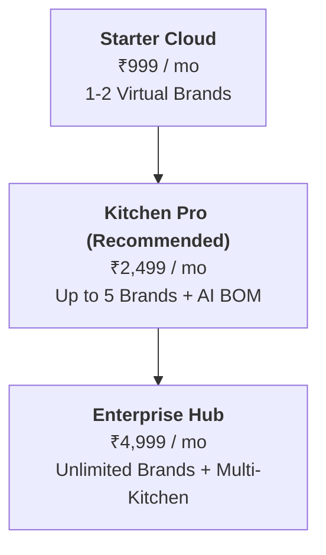

# KitchFlow OS — Comprehensive Feature Matrix & SaaS Pricing Guide

This document provides a breakdown of all operational capabilities built into **KitchFlow**, their business value, and a recommended SaaS pricing model tailored for single-location and multi-brand cloud kitchens in India and emerging markets.

---

## 1. Feature Catalog & Operational Value

### Module A: Multi-Brand Order Aggregation & Live Dispatch
| Feature | Technical Description | Business & Kitchen Value |
| :--- | :--- | :--- |
| **Unified Live Queue (`/orders`)** | Real-time intake from Swiggy, Zomato, Direct Phone, and Walk-in POS with acoustic/visual order alert cues. | Eliminates 4 separate tablet devices; stops missed orders and kitchen chaos during peak rush. |
| **Virtual Brand Routing** | Color-coded brand tagging (`Biryani Central`, `Burger Box`, `Wrap Nation`) on tickets with distinct SKU recipes. | Allows a single kitchen team to run 3–10 virtual brands from the same facility without cross-brand contamination. |
| **Manual POS & Phone Order Creator** | Modal with dynamic conditional phone number & delivery address fields, brand switcher, and menu selector. | Captures direct high-margin delivery & takeaway orders with 0% aggregator commission. |
| **Channel Emergency Pause** | 1-tap master halt or granular storefront pause (`Swiggy Only`, `Zomato Only`). | Prevents algorithmic cancellation penalties and rider bottlenecks during power cuts or ingredient stockouts. |

---

### Module B: Smart KDS (Kitchen Display System) & Line Cooking
| Feature | Technical Description | Business & Kitchen Value |
| :--- | :--- | :--- |
| **Station-Split Routing (`/kds`)** | Routes dishes to individual cooking stations (`GRILL`, `FRY`, `DUM_BIRYANI`, `WOK`, `PIZZA`, `BEVERAGE`, `ASSEMBLY`). | Line cooks only see items assigned to their tawa/fryer; prevents kitchen clutter and food delays. |
| **Bilingual Voice & UI (English / हिंदी)** | Full UI localization toggle between English and Hindi (`लाइव ऑर्डर्स`, `केडीएस कुक`, etc.). | Allows non-English-speaking Indian line cooks and kitchen helpers to operate the system with zero training friction. |
| **Cook Role Isolation** | Role switcher (`OWNER` vs `LINE_COOK`) hiding margins, procurement prices, and aggregator settings on cook tablets. | Protects proprietary food recipes, financial margins, and platform credentials from kitchen staff. |
| **Dynamic Order Timers & Urgency Badges** | Target prep countdown with auto-shifting urgency states (`Accepted`, `Preparing`, `Ready for Rider`). | Reduces rider wait times, improving kitchen ratings on Swiggy and Zomato. |

---

### Module C: Dispatch Counter & Error-Free Packing
| Feature | Technical Description | Business & Kitchen Value |
| :--- | :--- | :--- |
| **Expo Packing Verification (`/packing`)** | Interactive digital checklist for cutleries, dips/sauces, napkins, tamper seals, and separated hot/cold beverages. | Prevents missing item complaints and customer refund chargebacks on delivery aggregators. |
| **1-Tap Handover & Rider Status** | Dispatches completed orders with clear delivery OTP and rider reference IDs. | Ensures smooth handoffs to delivery executives without crowd confusion at the pickup window. |

---

### Module D: Automated BOM Inventory & Recipe Auto-86
| Feature | Technical Description | Business & Kitchen Value |
| :--- | :--- | :--- |
| **Per-Portion Recipe Auto-Deduction** | Automatically calculates BOM (Bill of Materials) ingredient usage in grams, ml, and units upon order prep. | Tracks exact theoretical inventory consumption down to single grams without manual end-of-day weighing. |
| **Recipe Auto-86 Safeguard** | Automatically detects when key raw SKUs fall below safety thresholds and toggles dishes offline on Swiggy & Zomato. | Eliminates out-of-stock cancellations, saving the kitchen from aggregator algorithmic penalties. |
| **AI Recipe & BOM Estimator** | Voice-dictated dish creator with AI portion estimation for raw ingredients, prep stations, and packaging costs. | Allows kitchen owners to onboard a new menu item in 30 seconds simply by speaking its name. |
| **Permanent Stock Audit Ledger** | Immutable audit trail tracking every gram (`WASTAGE_SPOILAGE`, `PURCHASE_INFLOW`, `RECIPE_AUTO_CONSUMPTION`). | Eliminates internal kitchen pilferage and unexplained ingredient leakage. |

---

### Module E: Procurement, Supplier POs & Discrepancy Reconciliation
| Feature | Technical Description | Business & Kitchen Value |
| :--- | :--- | :--- |
| **Smart Purchase Order Indenting** | 1-click PO generator with automated forecasting modes: *Manual*, *Low-Stock Replenish*, *7-Day Weekly*, *30-Day Monthly*. | Automates wholesale purchasing; prevents stockouts while avoiding over-ordering perishable goods. |
| **Vendor WhatsApp Order Dispatch** | Formats clean, structured purchase orders with items, quantities, and cost estimates, and launches WhatsApp with 1 tap. | Zero friction for Indian wholesale suppliers and local mandi vendors who operate exclusively on WhatsApp. |
| **Delivery Intake & Discrepancy Reconciliation** | "Inspect & Reconcile" intake modal allowing operators to enter actual received quantities when vendors deliver short. | Prevents paying vendors for goods they did not deliver; auto-adjusts stock and bills accurately. |
| **1-Tap Shift Wastage & Spoilage Log** | Modal to log burnt, dropped, or spoiled items with estimated ₹ loss preview. | Gives owners complete visibility into kitchen waste costs to improve cook discipline and reduce food costs. |
| **Accounting & GST CSV Exports** | 1-click export of historical Supplier POs and the Stock Audit Ledger into formatted CSV files. | Saves hours of bookkeeping work for accountants and GST tax filing. |

---

### Module F: Contribution Margin & Unit Economics Engine
| Feature | Technical Description | Business & Kitchen Value |
| :--- | :--- | :--- |
| **Per-Order True Net Margin (`/margins`)** | Calculates gross order value, packaging fees, aggregator commissions (18–25%), food BOM, and taxes. | Shows true in-pocket profit per dish instead of misleading aggregator gross sales numbers. |
| **Channel Profitability Comparison** | Side-by-side margin comparison between Swiggy, Zomato, Direct Takeaway, and POS Walk-in. | Identifies which brands and platforms are actually profitable vs. which are losing money on discounts. |

---

### Module G: Progressive Web App (PWA) Architecture
| Feature | Technical Description | Business & Kitchen Value |
| :--- | :--- | :--- |
| **Zero App-Store Standalone Install** | Runs natively on any low-cost Android tablet, iPad, or smartphone via web browser installation. | No need to buy expensive proprietary POS hardware; runs smoothly on ₹6,000–₹10,000 tablets. |
| **Network-First Offline Resilience** | Offline caching with custom service worker ensures zero downtime even during spotty kitchen Wi-Fi. | The kitchen ticket system continues functioning without interruptions during connection drops. |

---

## 2. Proposed SaaS Pricing Tiers

Based on typical Indian cloud kitchen and F&B SaaS economics (e.g., UrbanPiper, Petpooja, Posist), here is a recommended 3-tier pricing strategy:

### Tier 1: Starter Cloud (For Small Cloud Kitchens / Dark Kitchens)
* **Price**: **₹999 / month** (or ₹9,999 / year billed annually)
* **Target Audience**: Single kitchen running 1 to 2 delivery brands.
* **Included Features**:
  - Up to 2 Virtual Brands
  - Unified Live Order Dispatch Queue
  - Standard KDS Cook Station Display
  - Dispatch Packing Checklist
  - Manual Stock Adjustments & Basic Ledger
  - English & Hindi UI Localization
  - PWA Tablet & Mobile App

---

### Tier 2: Kitchen Pro (Most Popular / Standard SaaS Tier)
* **Price**: **₹2,499 / month** (or ₹24,999 / year billed annually)
* **Target Audience**: Growing multi-brand cloud kitchens operating 3 to 6 virtual brands.
* **Included Features**:
  - **Everything in Starter, plus:**
  - Up to 6 Virtual Brands
  - **Station-Split KDS** (Grill, Fry, Wok, Pizza, Biryani, Assembly)
  - **Full Recipe BOM Auto-Deduction** & Recipe Auto-86 Safeguard
  - **AI Voice Recipe BOM Estimator**
  - **Supplier Purchase Order (PO) Management & WhatsApp Dispatch**
  - **Delivery Intake & Discrepancy Reconciliation**
  - **Shift Wastage & Spoilage Logging**
  - **Contribution Margin & Financial Analytics Engine**
  - Role-based Access Control (`Owner` vs `Cook`)

---

### Tier 3: Kitchen Enterprise / Multi-Outlet Chain
* **Price**: **₹4,999 / month per outlet** (or ₹49,999 / year per outlet)
* **Target Audience**: Large cloud kitchen networks, franchises, and commercial food halls.
* **Included Features**:
  - **Everything in Pro, plus:**
  - **Unlimited Virtual Brands**
  - **Excel / CSV Financial & Audit Ledger Exporting**
  - Multi-location Kitchen Switching
  - Central Commissary / Base Kitchen Stock Transfer POs
  - Custom Commission Rate Configurations per Outlet
  - Dedicated Account Manager & Priority WhatsApp Support
  - Custom Hardware Setup Assistance

---

## 3. High-Value Add-Ons (Optional Recurring Revenue)

| Add-On | Pricing | Description |
| :--- | :--- | :--- |
| **Aggregator Direct API Auto-Sync** | + ₹999 / mo | Direct official webhooks for Swiggy & Zomato order acceptance and automatic 86 sync. |
| **WhatsApp Automated Cook Alerts** | + ₹499 / mo | Automated WhatsApp alerts sent to kitchen owner when a critical SKU hits zero. |
| **Additional Tablet License** | + ₹299 / mo / screen | Connect more than 4 dedicated KDS cook screens simultaneously. |
