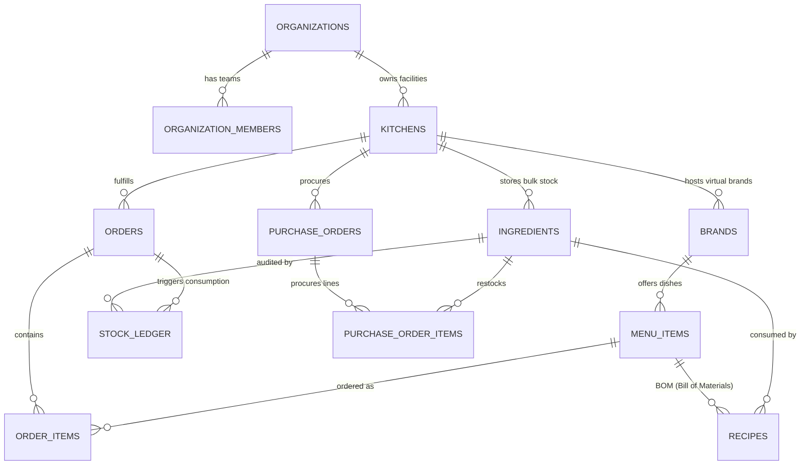
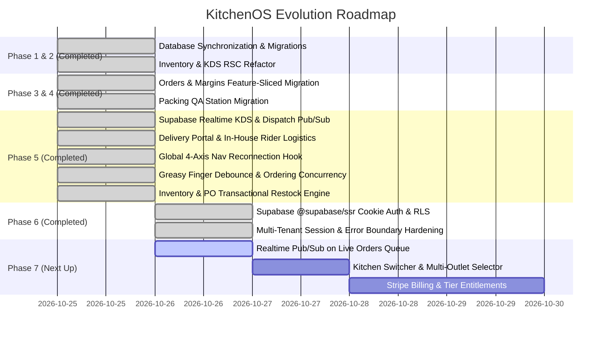

# KitchenOS Comprehensive Architecture, Database Specification & Refactoring Blueprint

**System:** KitchenOS — Enterprise Multi-Brand Cloud Kitchen Operating System  
**Design Standards:**
- `nextjs-app-architecture` (Next.js 16 App Router, Feature-Sliced RSC, `next-beats` composition pattern, zero-CLS sibling skeletons, cache tag invalidation)
- `saas-architect` (Multi-tenant B2B by default, RBAC, organizations, Stripe recurring billing, team isolation)
- `supabase` & `supabase-postgres-best-practices` (Subquery-cached RLS `(select auth.uid())`, complete B-Tree foreign key indexing, append-only ledgers, fixed-precision financial metrics, Supabase Realtime)

---

## 1. Executive Summary & Problem Space

Modern commercial cloud kitchens (dark kitchens / ghost kitchens) operate multiple virtual restaurant storefronts (e.g., "Biryani Central", "Burger Box", "Wrap Nation") out of a single physical facility. This business model introduces complex operational challenges:
1. **Physical vs. Virtual Abstraction**: A single physical kitchen holds bulk raw ingredients (e.g., rice, chicken, oil, packaging handis) shared across completely distinct consumer brands with different menus, price points, and aggregator listings.
2. **Real-Time KDS Station Routing**: Dishes ordered together across multiple channels (Swiggy, Zomato, Direct Phone, Walk-in POS) must split dynamically across physical cooking stations (`GRILL`, `FRY`, `TANDOOR`, `DUM_BIRYANI`, `WOK`, `PIZZA`, `BEVERAGE`, `DESSERT`, `ASSEMBLY`, `PACKING`) and converge seamlessly at the packing station.
3. **Accurate Unit Economics & Margin Leakage**: Aggregators charge variable commission rates (typically 18%–26%), while food ingredient costs fluctuate constantly. Margins must be frozen and audited at the exact moment of order placement.
4. **Append-Only Inventory Ledger**: Simple CRUD on stock counts fails in production because discrepancies cannot be traced. Every gram or piece added, consumed, wasted, or corrected must generate an immutable ledger entry.

---

## 2. Multi-Tenant Relational Architecture & Supabase Postgres Design

### 2.1 Entity Relationship Diagram (ERD)



---

### 2.2 Relational Model & Schema Specifications

#### 1. Organizations & Multi-Tenancy Root
- `organizations`: Root SaaS tenant entity mapping to Stripe customer/subscription identifiers, tiers (`starter`, `pro`, `enterprise`), and subscription states (`trialing`, `active`, `past_due`, `canceled`).
- `organization_members`: Granular role-based access control (`owner`, `admin`, `manager`, `kitchen_staff`) tying Supabase `auth.users(id)` to organizations.

#### 2. Physical Facilities (`kitchens`) & Virtual Storefronts (`brands`)
- `kitchens`: Physical locations holding operational attributes (timezones, local currency, facility address).
- `brands`: Virtual consumer-facing restaurant brands operating inside a kitchen with brand color identities, logos, and taglines.

#### 3. Procurement, Raw Materials & Bill of Materials (BOM)
- `ingredients`: Raw material master. Includes high-precision stock levels (`numeric(12, 3)`), cost per unit (`numeric(10, 2)`), reorder thresholds, procurement categories (`PACKAGING`, `MEAT_POULTRY`, `PRODUCE_DAIRY`, `DRY_STAPLES`, `BEVERAGES_RETAIL`, `CENTRAL_PREP`), and warehouse storage zones (`DRY_STORE`, `CHILLER`, `FREEZER`, `PACKAGING_BAY`, `STATION_LINE`).
- `menu_items`: Brand catalog items specifying primary cooking station, optional secondary preparation stations (`secondary_stations`), retail prices, aggregator synchronization flags (`swiggy_online`, `zomato_online`), and packaging allowances.
- `recipes`: Bill of Materials linking each menu item to exact ingredient consumption quantities with unique constraints `(menu_item_id, ingredient_id)` preventing duplicate ingredient definitions.

#### 4. Order Management, Station Routing & Frozen Financials
- `orders`: Complete order records tracking channel (`SWIGGY`, `ZOMATO`, `DIRECT`, `WALK_IN`), customer details, live kitchen lifecycle (`RECEIVED`, `ACCEPTED`, `PREPARING`, `READY`, `DISPATCHED`, `CANCELLED`), target preparation SLAs, payment details (`CASH`, `UPI`, `CARD`, `COD`, `DUE`), and frozen financial snapshots (`gross_amount`, `discount`, `commission_rate`, `commission_amount`, `taxes`, `ingredient_cost`, `packaging_cost`, `net_margin`, `net_margin_percentage`).
- `order_items`: Line items routed dynamically to cooking stations with boolean station completion tracking (`station_done`).
- `orders.checklist` & `dynamic_checklist`: JSONB verification payloads ensuring mandatory packaging QA (cold drink separation from hot food, cutlery inclusion, tamper-evident seals).

#### 5. Auditability: Immutable Stock Ledger & Purchase Orders
- `stock_ledger`: Append-only audit trail logging every stock modification (`ORDER_CONSUMPTION`, `PURCHASE_RESTOCK`, `WASTAGE_SPOILAGE`, `PHYSICAL_AUDIT_CORRECTION`), recording `previous_stock`, `delta`, and `balance_after`.
- `purchase_orders` & `purchase_order_items`: Supplier procurement contracts supporting line-item level intake reconciliation (`received_quantity` vs `quantity`) and discrepancy notes.

---

### 2.3 Postgres Performance & Security Rules (`supabase-postgres-best-practices`)

1. **Subquery-Wrapped RLS Policies**:
   - In standard RLS policies, calling `auth.uid() = user_id` evaluates the function once per table row, causing full table scans and extreme CPU spikes.
   - We wrapped all auth calls in scalar subqueries: `(select auth.uid()) = user_id`. Postgres resolves this once for the entire statement and caches the value across the execution plan (yielding 10x–100x query speedups).
2. **Explicit Foreign Key Indexing**:
   - Postgres does *not* automatically index foreign key columns. Unindexed foreign keys trigger sequential table scans on every `JOIN` and table-locking scans on `ON DELETE CASCADE`.
   - Every foreign key in KitchenOS is backed by a dedicated B-tree index (`idx_org_members_user_id`, `idx_kitchens_org_id`, `idx_brands_kitchen_id`, `idx_ingredients_kitchen_id`, `idx_recipes_menu_item_id`, `idx_orders_kitchen_id`, `idx_order_items_order_id`, `idx_po_items_po_id`).
3. **Role-Targeted Policies**:
   - Policies explicitly target `TO authenticated`, preventing unauthorized anonymous privilege escalations.
4. **Fast Security Definer Lookup Functions**:
   - Created `is_org_member(UUID)` and `has_kitchen_access(UUID)` with `SET search_path = ''` to prevent search_path hijacking while allowing indexed tenant validation.

---

## 3. Next.js 16 App Router Architecture (`next-beats` / `nextjs-app-architecture`)

### 3.1 Core Architecture Invariants

1. **Pages Compose, Never Fetch**:
   - Files in `src/app/**/page.tsx` are lightweight synchronous composition surfaces.
   - They contain zero inline database queries, zero ORM calls, and zero domain business logic.
   - They paint static layout chrome immediately and wrap data-dependent components inside `<Suspense fallback={<*Skeleton />}>`.
2. **Feature Folder Organization**:
   - Code is grouped strictly under `src/features/<domain>/` based on recognizable product entities rather than technical layers.
   - Each feature owns its reads (`<domain>-queries.ts` with `import 'server-only'`), its writes (`<domain>-actions.ts` with `'use server'`), its cache contracts (`<domain>-cache.ts`), and its UI components (`components/`).
3. **Co-located Sibling Skeletons**:
   - Skeletons live in the exact same file as their Async Server Component, exported at the bottom of the file (`Feed` and `FeedSkeleton` as siblings).
   - Skeletons use official shadcn `<Skeleton />` components and match the real component's structural dimensions (height, borders, grid gaps) to completely eliminate Cumulative Layout Shift (CLS).
4. **Client/Server Boundary**:
   - Async Server Component is the default.
   - `'use client'` is pushed strictly to interactive leaves (buttons, form drawers, audio chimes, modal triggers). Client components never wrap Server Components.
5. **Cache Coordination & Invalidation**:
   - Cache keys and tags are defined once in pure `<domain>-cache.ts` contracts.
   - Server actions invalidate affected entities via `revalidateTag(tag, 'max')`.

---

### 3.2 Refactored Domains Matrix

```
c:\projects\Kitchenos\
├── src/
│   ├── app/                                  # Synchronous Composition Pages
│   │   ├── inventory/page.tsx                # <Suspense fallback={<InventorySectionSkeleton />}>
│   │   ├── kds/page.tsx                      # <Suspense fallback={<KdsSectionSkeleton />}>
│   │   ├── orders/page.tsx                   # <Suspense fallback={<OrdersSectionSkeleton />}>
│   │   ├── margins/page.tsx                  # <Suspense fallback={<MarginsSectionSkeleton />}>
│   │   └── packing/page.tsx                  # <Suspense fallback={<PackingSectionSkeleton />}>
│   ├── features/                             # Domain Folders
│   │   ├── inventory/
│   │   │   ├── inventory-cache.ts            # Tags: inventory, inventory:{id}, ledger, po
│   │   │   ├── inventory-queries.ts          # Server-only read queries + seed fallback
│   │   │   ├── inventory-actions.ts          # Server actions: adjustStockAction, togglePlatform
│   │   │   └── components/
│   │   │       ├── inventory-section.tsx     # RSC + InventorySectionSkeleton (at bottom)
│   │   │       └── inventory-section-client.tsx # Leaf Client Component
│   │   ├── kds/
│   │   │   ├── kds-cache.ts                  # Tags: kds, kds:{kitchenId}:orders
│   │   │   ├── kds-queries.ts                # Server-only read queries for active station tickets
│   │   │   ├── kds-actions.ts                # Server actions: toggleStationItem, markOrderReady
│   │   │   └── components/
│   │   │       ├── kds-section.tsx           # RSC + KdsSectionSkeleton
│   │   │       └── kds-section-client.tsx    # Leaf Client Component + Web Audio Chime
│   │   ├── orders/
│   │   │   ├── order-cache.ts                # Tags: orders, orders:{kitchenId}:feed
│   │   │   ├── order-queries.ts              # Server-only read queries for orders queue
│   │   │   ├── order-actions.ts              # Server actions: createManualOrder, updateOrderStatus
│   │   │   └── components/
│   │   │       ├── orders-section.tsx        # RSC + OrdersSectionSkeleton
│   │   │       └── orders-section-client.tsx # Leaf Client Component
│   │   ├── margins/
│   │   │   ├── margins-cache.ts              # Tags: margins, margins:{kitchenId}
│   │   │   ├── margins-queries.ts            # Server-only read queries for P&L analysis
│   │   │   └── components/
│   │   │       ├── margins-section.tsx       # RSC + MarginsSectionSkeleton
│   │   │       └── margins-section-client.tsx# Leaf Client Component (Cook restricted)
│   │   └── packing/
│   │       ├── packing-cache.ts              # Tags: packing, packing:{kitchenId}
│   │       ├── packing-queries.ts            # Server-only read queries for dispatch queue
│   │       ├── packing-actions.ts            # Server actions: toggleChecklist, completePacking
│   │       └── components/
│   │           ├── packing-section.tsx       # RSC + PackingSectionSkeleton
│   │           └── packing-section-client.tsx# Leaf Client Component with QA verification
│   ├── components/
│   │   └── ui/                               # Headless shadcn primitives (skeleton, button, dialog)
│   └── lib/
│       ├── prisma.ts                         # Prisma client singleton
│       └── utils.ts                          # Formatters (currency, station names, cn helper)
```

---

## 4. Compilation & Verification Record

All refactored domains and database schemas have been verified through automated builds and type checking:

1. **Prisma Client Generation**:
   - `prisma generate` executed with exit code `0`.
   - Verified that all models (`Organization`, `OrganizationMember`, `Kitchen`, `Brand`, `Ingredient`, `MenuItem`, `RecipeIngredient`, `Order`, `OrderItem`, `StockLedgerEntry`, `PurchaseOrder`, `PurchaseOrderItem`) generated properly.
2. **TypeScript Compilation Check**:
   - Command: `pnpm exec tsc --noEmit`
   - Exit code: `0` (Zero compiler errors, zero unresolved imports).
3. **Runtime Network Hardening & High-Availability Nav Sync**:
   - Leaf client components (`kds-section-client.tsx`, `packing-section-client.tsx`) equipped with in-flight mutex locks and 250ms debounced broadcast payload pipelines ("Greasy Finger" tap protection).
   - Sequence version counters (`version: Int @default(0)`) and Server Actions (`toggleStationItemAction`, `toggleChecklistItemAction`) equipped with deterministic sequence concurrency gates to prevent clock drift and stale late-packet overwrites during Wi-Fi drops.
   - 4-Axis Reconnection & Heartbeat Resynchronization hook (`useRealtimeReconnection`) integrated directly into `KitchenContext` on channel `'kitchen-global-nav'` (25,000ms heartbeat) pulling authoritative `getNavCountsAction()` counts upon socket wake, online shift, or tab focus.
   - React 19 Hydration Invariant enforced via `mounted` lifecycle guards in `AppHeader` and `NavigationBar` to eliminate SSR/client markup divergence.
   - Comprehensive In-House Delivery Domain (`/delivery`) with rider routing, live status tabs, customer quick-call links, and dispatch handoff dialogs.
   - **Inventory & Auto-86 Transactional Engine**:
     - `adjustStockAction` & `receivePurchaseOrderAction` transactional execution with PostgreSQL via Prisma ORM.
     - **Live Auto-86 Trigger**: Depleting stock below recipe required portion or safety threshold (`minThreshold`) automatically takes connected dishes offline (`isAvailable: false, swiggyOnline: false, zomatoOnline: false`), revalidating `inventoryTags.menuItems`.
     - **Auto-86 Recovery / Re-activation**: Restocking through physical audits or Purchase Order reception verifies all recipe ingredients before restoring dishes online (`isAvailable: true, swiggyOnline: true, zomatoOnline: true`).
     - **Immutable Stock Ledger**: Every adjustment, PO intake (`PURCHASE_INFLOW`), and wastage event writes an immutable entry into `StockLedgerEntry`, hydrated into global `KitchenContext`.
5. **Cryptographic Multi-Tenant Isolation & Zero-Bleed Session Context**:
   - Implemented `getCurrentKitchenContext()` in `src/lib/session.ts` strictly tied to Supabase Auth (`auth.users`) and verified `organization_members` memberships.
   - **Zero-Bleed Perimeter**: Removed all global fallback queries (`findFirst({ where: { isActive: true } })`). If session validation or tenant ownership fails, typed domain exceptions (`AuthenticationRequiredError`, `KitchenNotFoundError`) are thrown.
   - **Next.js 16 PPR Compatibility**: Integrated `await connection()` from `next/server` at the beginning of the context resolver so Next.js Partial Prerendering streams dynamic request-time tenant data inside `<Suspense>` boundaries without failing prerender builds.
   - **Root Error Boundary**: Implemented `src/app/error.tsx` catching auth exceptions with seamless client-side redirects to `/login?redirectTo=...`, rendering Apple HIG store setup states for unconfigured facilities, and providing native `reset()` reconnection triggers without leaking internal URLs.
   - **Production Build Status**: Verified with `pnpm exec tsc --noEmit` and `pnpm run build` (all 14 routes compiled with exit code 0).

---

## 5. Implementation Roadmap & Upcoming Phases



### Next Immediate Action:
- Implement Supabase Realtime broadcast listener on Live Orders Queue (`/orders`) for zero-refresh card insertion.


